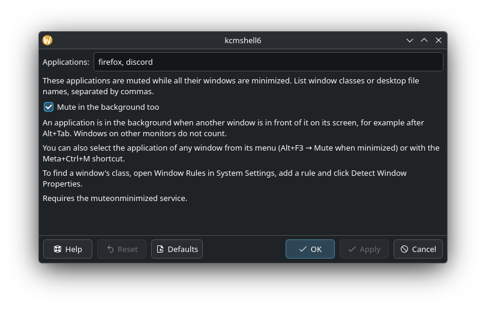

# MuteOnMinimize

[](https://github.com/BeleBob/MuteOnMinimize/releases/latest)
[](https://github.com/BeleBob/MuteOnMinimize/actions/workflows/ci.yml)
[](LICENSE)

**По-русски:** [README.md](README.md)

A KDE Plasma 6 add-on that mutes selected applications while their windows are minimized or
behind other windows, and brings their sound back as soon as you return to them.
Handy for games and players: minimize or Alt+Tab away — silence; come back — sound.



## Features

- An application is muted when **all** its windows are minimized.
- By default, also when another window is in front of it on its screen, for example after Alt+Tab.
  Windows on other monitors do not count: working on a second monitor keeps the sound.
  Turn this off with *Mute in the background too*.
- Sound fades out over a second and comes back at once.
- Pick applications from the window menu, with a shortcut, or as a list in the settings.
- Works with PulseAudio and PipeWire streams, programs that play from child processes
  (Discord and other Electron apps), Wine/Proton games and Flatpak apps.
- Your own mute is never touched and nothing is saved: an application closed while muted
  starts with sound next time.
- English, Russian, Ukrainian and German, following the system language.

Requires KDE Plasma 6 (Wayland or X11) and PipeWire.

## Installation

### Arch Linux, CachyOS and other Arch-based systems

The package from the [latest release](https://github.com/BeleBob/MuteOnMinimize/releases/latest):

```sh
sudo pacman -U https://github.com/BeleBob/MuteOnMinimize/releases/download/v0.1.1/muteonminimize-0.1.1-1-x86_64.pkg.tar.zst
```

The AUR packages `muteonminimize` and `muteonminimize-git` are ready and will be published once the AUR
reopens registration. Until then you can build them yourself:

```sh
git clone https://github.com/BeleBob/MuteOnMinimize.git
cd MuteOnMinimize/packaging/aur/muteonminimize
makepkg -si
```

### From source (any distribution)

You need Rust 1.88 or newer ([rustup](https://rustup.rs) if your distribution ships an older one), `clang`,
`make`, `gettext`, `pkg-config` and the PipeWire headers. On Arch: `rust clang make gettext libpipewire`;
on Debian and Ubuntu: `clang libclang-dev make gettext pkg-config libpipewire-0.3-dev`.

```sh
git clone https://github.com/BeleBob/MuteOnMinimize.git
cd MuteOnMinimize
./install.sh               # into ~/.local, no root; run again to update
```

Or system-wide: `make && sudo make install`.

## Setup

1. Enable the script: *System Settings → Window Management → KWin Scripts → **Mute on Minimize***.
2. Select applications in any of these ways:
   - **Window menu:** Alt+F3 (or right-click the title bar) → *Mute when minimized*.
     Firefox and other programs that draw their own title bar show their own menu on right-click;
     use Alt+F3 for them.
   - **Meta+Ctrl+M** toggles the active window's application; an on-screen message confirms it.
     Change the shortcut under *System Settings → Shortcuts → KWin*.
   - **The script's settings page** (the settings button next to it): a comma-separated list.

The list takes window classes (for example `firefox`, `discord`, `steam_app_287700`) or desktop file names.
To find a window's class, open *System Settings → Window Rules*, add a rule and click *Detect Window Properties*.

### Meta+D

By default Meta+D in Plasma does not minimize windows, it only hides them (*Peek at Desktop*),
so it does not mute anything. To make Meta+D minimize windows:

1. *System Settings → Window Management → KWin Scripts*: enable *MinimizeAll*.
2. *System Settings → Shortcuts → KWin*: remove Meta+D from *Peek at Desktop* and assign it to
   *Minimize all windows*.

## Troubleshooting

- **An application is not muted.** Check that the script is enabled and that the list has the window class,
  not the title (for example `mgsvtpp.exe`, not `METAL GEAR SOLID V`). See what the service does:
  ```sh
  systemctl --user status muteonminimized
  journalctl --user -u muteonminimized -f
  ```
  Muting logs `Muting "<application>"`, bringing the sound back logs `Unmuting`.
- **Sound did not come back.** `systemctl --user restart muteonminimized`: when the service stops it gives
  back every stream it muted.
- **The mixer shows a muted application as playing.** That is intended: the add-on uses a mechanism separate
  from your own mute, so that it never changes your settings or the saved volumes.

Please report problems in [Issues](https://github.com/BeleBob/MuteOnMinimize/issues), in English or Russian.

## Uninstalling

- Package: `sudo pacman -R muteonminimize`.
- Installed with `install.sh`: `./install.sh --uninstall`.

## How it works

A KWin script watches the windows and tells a small user service, `muteonminimized`, which processes to mute;
the service mutes their audio streams in PipeWire. See [docs/ARCHITECTURE.md](docs/ARCHITECTURE.md).

## Contributing and translations

Building, testing and adding a language are described in [CONTRIBUTING.md](CONTRIBUTING.md).
Changes are listed in [CHANGELOG.md](CHANGELOG.md).

## License

GPL-3.0-or-later, see [LICENSE](LICENSE).
