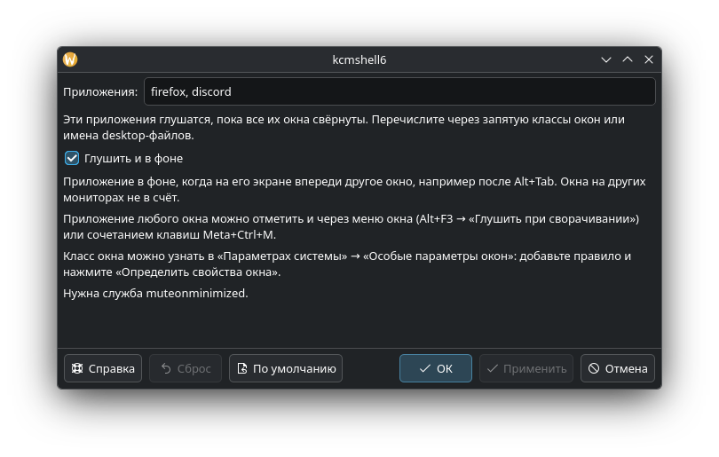

# MuteOnMinimize

[](https://github.com/BeleBob/MuteOnMinimize/releases/latest)
[](https://github.com/BeleBob/MuteOnMinimize/actions/workflows/ci.yml)
[](LICENSE)

**English:** [README.en.md](README.en.md)

Дополнение для KDE Plasma 6: выбранные приложения замолкают, пока их окна свёрнуты
или закрыты другими окнами, и снова звучат, как только вы к ним вернулись.
Удобно для игр и плееров: свернули или переключились через Alt+Tab — тишина, вернулись — звук.



## Возможности

- Приложение замолкает, когда свёрнуты **все** его окна.
- По умолчанию — и когда на его экране впереди другое окно, например после Alt+Tab.
  Окна на других мониторах не в счёт: если вы работаете на втором мониторе, звук остаётся.
  Этот режим отключается галочкой «Глушить и в фоне».
- Звук плавно затухает за секунду, а возвращается сразу.
- Приложения выбираются в меню окна, сочетанием клавиш или списком в настройках.
- Работает со звуком через PulseAudio и PipeWire, с программами, которые играют из дочерних процессов
  (Discord и другие на Electron), с играми под Wine/Proton и с приложениями из Flatpak.
- Ваш собственный mute не трогается, и глушение нигде не сохраняется: приложение, закрытое
  в заглушённом состоянии, в следующий раз запустится со звуком.
- Интерфейс на английском, русском, украинском и немецком — по языку системы.

Нужны KDE Plasma 6 (Wayland или X11) и PipeWire.

## Установка

### Arch Linux, CachyOS и другие на основе Arch

Готовый пакет из [последнего релиза](https://github.com/BeleBob/MuteOnMinimize/releases/latest):

```sh
sudo pacman -U https://github.com/BeleBob/MuteOnMinimize/releases/download/v0.1.0/muteonminimize-0.1.0-1-x86_64.pkg.tar.zst
```

Пакеты `muteonminimize` и `muteonminimize-git` для AUR готовы и появятся там, когда AUR снова откроет
регистрацию. До тех пор их можно собрать самому:

```sh
git clone https://github.com/BeleBob/MuteOnMinimize.git
cd MuteOnMinimize/packaging/aur/muteonminimize
makepkg -si
```

### Из исходников (любой дистрибутив)

Нужны Rust 1.88 или новее (если в дистрибутиве старее — через [rustup](https://rustup.rs)), `clang`, `make`,
`gettext`, `pkg-config` и заголовки PipeWire. В Arch это пакеты `rust clang make gettext libpipewire`,
в Debian и Ubuntu — `clang libclang-dev make gettext pkg-config libpipewire-0.3-dev`.

```sh
git clone https://github.com/BeleBob/MuteOnMinimize.git
cd MuteOnMinimize
./install.sh               # в ~/.local, без root; повторный запуск обновляет
```

Или для всей системы: `make && sudo make install`.

## Настройка

1. Включите сценарий: «Параметры системы» → «Диспетчер окон» → «Сценарии KWin» → **Тишина при сворачивании**.
2. Выберите приложения любым способом:
   - **Меню окна:** Alt+F3 (или правый клик по заголовку) → «Глушить при сворачивании».
     Firefox и другие программы, которые рисуют заголовок сами, показывают по правому клику своё меню —
     для них используйте Alt+F3.
   - **Сочетание клавиш Meta+Ctrl+M** — для активного окна. На экране появится подсказка.
     Сменить его можно в «Параметрах системы» → «Комбинации клавиш» → KWin.
   - **Страница настроек** сценария (значок настроек рядом с ним): список через запятую.

В списке указывается класс окна (например, `firefox`, `discord`, `steam_app_287700`) или имя desktop-файла.
Класс окна можно узнать в «Параметрах системы» → «Особые параметры окон»: добавьте правило
и нажмите «Определить свойства окна».

### Win+D

Win+D в Plasma по умолчанию не сворачивает окна, а только прячет их («Взглянуть на рабочий стол»),
и глушение по нему не срабатывает. Чтобы Win+D сворачивал окна:

1. «Параметры системы» → «Диспетчер окон» → «Сценарии KWin» → включите «Сворачивание всех окон».
2. «Параметры системы» → «Комбинации клавиш» → KWin: снимите Meta+D с «Взглянуть на рабочий стол»
   и назначьте его действию «Minimize all windows».

## Если что-то не так

- **Приложение не глушится.** Проверьте, что сценарий включён и что в списке именно класс окна, а не заголовок
  (например, `mgsvtpp.exe`, а не `METAL GEAR SOLID V`). Посмотрите, что делает служба:
  ```sh
  systemctl --user status muteonminimized
  journalctl --user -u muteonminimized -f
  ```
  При глушении в журнале появляется `Muting "<приложение>"`, при возврате — `Unmuting`.
- **Звук не вернулся.** `systemctl --user restart muteonminimized` — при остановке служба возвращает звук
  всем потокам, которые заглушила.
- **В микшере заглушённое приложение выглядит звучащим.** Так задумано: дополнение использует отдельный
  от вашего mute механизм, чтобы не трогать ваши настройки и не попадать в сохранённую громкость.

О проблемах пишите в [Issues](https://github.com/BeleBob/MuteOnMinimize/issues) — по-русски или по-английски.

## Удаление

- Пакет: `sudo pacman -R muteonminimize`.
- Установка через `install.sh`: `./install.sh --uninstall`.

## Как это устроено

Сценарий KWin следит за окнами и сообщает небольшой пользовательской службе `muteonminimized`,
какие процессы заглушить; служба глушит их звуковые потоки в PipeWire. Подробнее —
в [docs/ARCHITECTURE.md](docs/ARCHITECTURE.md) (на английском).

## Участие и перевод

Сборка, тесты и добавление языка описаны в [CONTRIBUTING.md](CONTRIBUTING.md).
Список изменений — в [CHANGELOG.md](CHANGELOG.md).

## Лицензия

GPL-3.0-or-later, см. [LICENSE](LICENSE).
